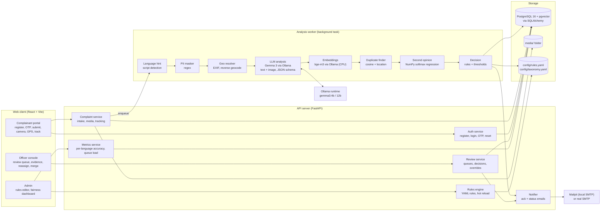
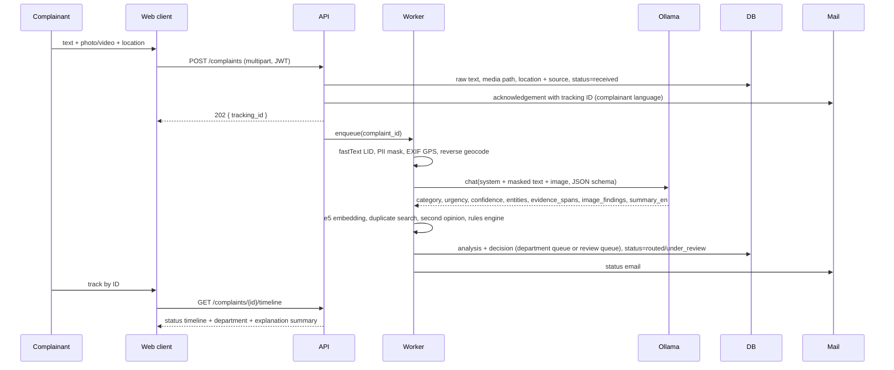

# SYNAPSE: System Architecture

## Phase 2 - Checkpoint 2

Covers: architecture diagram, component responsibilities, technology stack with justification, and data flow.

Date: 15 October 2026 | Status: Draft v1

---

## 1. Design principles

1. **Local-first.** Every model runs on our own machine through Ollama and Python. No cloud AI APIs. Complaint text, photos and location never leave the server.
2. **Human authority.** The system recommends; an officer decides. Uncertain, Critical, disagreeing and duplicate cases always pass through a person. Nothing is auto-closed.
3. **Explainable by construction.** Every recommendation carries evidence spans, matched rules, image findings and a confidence score.
4. **Config over code.** Departments, urgency criteria and routing rules live in YAML files that an administrator edits without a redeploy.
5. **Async analysis.** A local LLM takes seconds to tens of seconds. The complainant gets an ID and an acknowledgement instantly; analysis runs in the background and updates status when done.
6. **Fail safe, not fail silent.** If a model is down or times out, the complaint lands in the human review queue with status "awaiting analysis".

---

## 2. Architecture diagram



Plain-text version for the slide:

```
Browser (React)                 API server (FastAPI)              Analysis worker (same process, background)
 Complainant portal   ---->      Auth + OTP                          script-based language hint
 Officer console      ---->      Complaints + media                  PII masking (regex)
 Admin rules/metrics  ---->      Review + overrides                  Geo resolve (EXIF, offline nearest locality)
                                 Rules engine (YAML)                 Gemma 3 via Ollama (text + image -> JSON)
                                 Notifier (SMTP)                     bge-m3 embeddings (Ollama) -> duplicates + second opinion
                                 Metrics                             Decision: rules + thresholds -> queue
                                        |                                      |
                                        v                                      v
                                 PostgreSQL + pgvector  <--------------  analysis, decision, audit
                                 media/ folder                         Mailpit / SMTP  <-- ack + status emails
                                 config/*.yaml
```

---

## 3. Components and responsibilities

| Component | Responsibility | Owns | Talks to |
|---|---|---|---|
| **Complainant portal** | Register, verify OTP, log in, reset password, submit complaint with text, photo/video (upload or in-app camera), location (GPS, current-location button, manual), track status by ID | UI state, camera, geolocation | Auth, Complaint service |
| **Officer console** | Review queue sorted by urgency, see evidence (spans, image findings, rules, confidence, map), accept / reassign / merge / correct urgency, add reason | nothing persistent | Review service |
| **Admin** | Edit routing rules and taxonomy, view fairness dashboard (accuracy per language and category), queue load, backlog by department | nothing persistent | Rules engine, Metrics |
| **Auth service** | Registration (mobile, email, strong password), argon2 hashing, 6-digit email OTP with 10-minute expiry, JWT sessions, role (complainant / officer / admin), forgot-password OTP flow, rate limiting | users, otps | DB, Notifier |
| **Complaint service** | Validate intake, store raw text untouched, save media to disk, record location and its source, issue tracking ID, send acknowledgement, enqueue analysis, serve tracking timeline | complaints, media, timeline | DB, media folder, Worker, Notifier |
| **Analysis worker** | Run the pipeline stages in order, write analysis and decision, never block the request thread, retry once on model timeout then fall back to review queue | analyses | Ollama, models in memory, DB, Notifier |
| **Rules engine** | Load YAML rules, evaluate keyword / regex / ward / language conditions, return forced department, urgency floor, force-review flag; hot-reload on file change | rules.yaml, taxonomy.yaml | Worker, Admin |
| **Review service** | Department and review queues, officer decisions, override log with who / when / why, merge duplicates, status transitions | decisions, overrides | DB, Notifier |
| **Notifier** | Email only: OTP, acknowledgement, under review, routed, resolved and other status mails in the complainant's language; every send logged. No SMS. WhatsApp is a roadmap item | notifications | SMTP (Mailpit) |
| **Metrics service** | Compare analyses against eval labels and officer corrections; accuracy per language, category, urgency, formality; review-queue rate; model latency | nothing (reads) | DB |
| **Ollama runtime** | Serve Gemma 3 with JSON-schema output and image input | model weights | Worker |
| **Storage** | PostgreSQL 16 with pgvector (Docker Compose) through SQLAlchemy; media folder; YAML config | everything | all services |

---

## 4. Technology stack and justification

| Layer | Choice | Why | Rejected alternative |
|---|---|---|---|
| Frontend | React 18 + Vite, Tailwind CSS, **shadcn/ui** components, **lucide-react** icons, react-router, react-hook-form + zod | Fast scaffold, accessible components out of the box, consistent look the jury can read, easy camera and geolocation access through browser APIs, responsive on phones | Plain server-rendered pages (harder camera UX); Next.js (overkill); MUI or Ant (heavier, less customisable) |
| Maps | Leaflet + react-leaflet, OpenStreetMap tiles | No API key, light, pins and ward polygons | Google Maps (key, terms) |
| Camera / GPS | `getUserMedia`, `<input capture>`, Geolocation API | Native browser features, work in mobile Chrome | Native app (out of scope) |
| UI languages | i18next with en / ta / hi JSON dictionaries | Portal itself must be readable in the complainant's language | Hard-coded English |
| Backend | Python 3.11 + FastAPI + Uvicorn | Same language as the ML libraries, async, auto-generated OpenAPI docs for the jury | Node/Express (would need a second process for Python models) |
| Background work | FastAPI `BackgroundTasks` + a single worker thread with a queue | No Redis or Celery to install; one process to run in the demo | Celery (setup time) |
| ORM / DB | SQLAlchemy 2 + PostgreSQL 16 with pgvector, started by Docker Compose | Relational integrity for an audit-heavy system, `jsonb` for explanation payloads, vector index in the same database; the laptop already runs Docker | SQLite (no concurrent writers, no vector index) |
| Vector search | pgvector HNSW index, cosine distance in SQL | Duplicate search is one query beside the complaint rows; survives restarts | FAISS, in-memory NumPy |
| LLM runtime | Ollama serving `gemma3:4b` (CPU / small GPU) or `gemma3:12b` (12 GB+ GPU) | Local, one installer, JSON-schema output, image input, prompt cache | llama.cpp direct (more wiring), vLLM (GPU only) |
| Language hint | Unicode script detection, pure Python | Three languages: Tamil script, Devanagari, Latin; the LLM decides Tanglish vs English | fastText (native DLL, blocked here) |
| Embeddings | `bge-m3` served by Ollama, 1024-dim | Strongest open multilingual embedding model; same runtime as Gemma; `num_gpu: 0` at runtime keeps the GPU for Gemma | sentence-transformers (needs torch, blocked here) |
| Second opinion | Softmax regression in NumPy | Trains in seconds, independent of the LLM, no scipy | scikit-learn (needs scipy, blocked here) |
| PII | Regex for Aadhaar, PAN, mobile, email, PIN | Indian patterns, deterministic | Presidio (500 MB, English) |
| Geocoding | Nearest locality from `config/places_tn.csv` (haversine, offline); Nominatim behind a flag | Works offline, zero dependencies; add localities as rows | `reverse_geocoder` (needs scipy, blocked here) |

Constraint found on the build laptop: Windows Application Control blocks unsigned native DLLs, so torch and scipy do not load. Every model therefore runs inside Ollama (signed binary), and the Python service uses only NumPy, pandas and Pillow on the native side.
| Auth | argon2-cffi, PyJWT, email OTP | Standard, no third-party identity provider | OAuth (needs cloud) |
| Email | smtplib to Mailpit (local SMTP + web inbox, from Docker Compose) in dev; real SMTP by env var | Fully local demo; OTP visible in a browser tab | SendGrid etc. (cloud) |
| Config | YAML (`rules.yaml`, `taxonomy.yaml`), hot reload by mtime | Admin-editable, diffable in git | DB-stored rules (needs an editor UI first) |
| Tests | pytest for pipeline stages; eval runner script | Metrics dashboard needs the eval runner anyway | none |

---

## 5. Data flow

### 5.1 Registration and login

1. Complainant submits mobile, email, password. API validates the password policy, hashes with argon2, stores the user as `unverified`.
2. API generates a 6-digit OTP, stores its hash with a 10-minute expiry, emails it through the Notifier.
3. Complainant enters the OTP. API checks hash and expiry, marks the user `verified`, returns a JWT.
4. Forgot password: same OTP flow; on success the new password replaces the old hash and all sessions are invalidated.

### 5.2 Complaint submission



### 5.3 Analysis pipeline, stage by stage

| Stage | Input | Output | Time (CPU / GPU) |
|---|---|---|---|
| 1. Language ID | raw text | primary + secondary language hint | 1 ms |
| 2. PII mask | raw text | masked text + entity map (kept in DB, shown only to authorised staff) | 1 ms |
| 3. Geo resolve | lat/lng (camera, EXIF, button) or manual address | lat/lng, place name, ward if polygon file exists, source tag | 10 ms |
| 4. LLM analysis | masked text + image (key frame) + taxonomy + urgency scale | JSON: language, category, urgency, confidence, entities, evidence_spans, image_findings, summary_en | 20-40 s / 3-6 s |
| 5. Embedding | summary_en | 1024-float vector (bge-m3 via Ollama, CPU) | 300 ms |
| 6. Duplicate search | vector + location + user | top-3 similar open complaints with score | 5 ms |
| 7. Second opinion | vector | category + probability from NumPy softmax regression | 1 ms |
| 8. Rules engine | masked text, language, ward, LLM output | forced department, urgency floor, force_review, matched rule IDs | 1 ms |
| 9. Decision | everything above | queue (department or review), reasons list | 1 ms |

### 5.4 Decision logic

```
urgency = max(llm.urgency, rules.urgency_floor)
department = rules.department or llm.category.department

route to REVIEW if any of:
  rules.force_review
  urgency == Critical
  llm.confidence < 0.70
  rules.department set and != llm department          (disagreement)
  second_opinion.category != llm.category and second_opinion.p > 0.6   (disagreement)
  duplicate.score >= 0.85                                 (merge candidate)
  analysis failed or timed out                            (awaiting analysis)
else route to DEPARTMENT queue
Never: auto-close, auto-reject.
```

Every reason that fired is stored and shown to the officer.

### 5.5 Officer review

1. Officer opens the review queue, sorted by urgency then age.
2. Sees raw text, masked entities, evidence spans highlighted, image and its findings, map pin, matched rules, confidence, second-opinion label, duplicate candidates.
3. Accepts, reassigns (department / urgency), merges into a duplicate, or sends back for more information. A reason is required.
4. Review service writes the override (who, when, from, to, why), updates status, triggers a status email.
5. Overrides feed the metrics service as ground truth and are exported for the next training run.

### 5.6 Metrics

The eval runner script replays `data/eval/complaints.jsonl` through the pipeline and compares with labels. The dashboard shows accuracy per language, category and urgency, the informal-vs-formal gap, review-queue rate, duplicate recall, and LLM latency. Officer corrections on live complaints are added as they happen.

---

## 6. API surface (first cut)

| Method | Path | Purpose |
|---|---|---|
| POST | `/auth/register` | mobile, email, password; sends OTP |
| POST | `/auth/verify-otp` | activates account, returns JWT |
| POST | `/auth/login` | returns JWT |
| POST | `/auth/forgot` | sends reset OTP |
| POST | `/auth/reset` | OTP + new password |
| POST | `/complaints` | multipart: text, language hint, media files, lat/lng, location source, manual address |
| GET | `/complaints/mine` | complainant's complaints |
| GET | `/complaints/{id}` | full record (role-filtered) |
| GET | `/complaints/{id}/timeline` | status history |
| POST | `/geo/reverse` | lat/lng to place / ward |
| GET | `/review/queue` | officer review queue |
| GET | `/departments/{dept}/queue` | department queue |
| POST | `/review/{id}/decision` | accept / reassign / merge / request-info with reason |
| GET | `/admin/rules` and PUT | read and edit routing rules |
| GET | `/admin/metrics` | dashboard data |
| POST | `/admin/eval/run` | replay eval set |
| GET | `/health` | Ollama reachable, models loaded, queue depth |

---

## 7. Repository layout

The layout as built (the day-one plan placed the pipeline in its own package; it ended up as services of the API):

```
backend/
  app/main.py              FastAPI app, routers, start-up (database, worker, outbox, model warm-up)
  app/api/                 auth.py complaints.py review.py staff.py admin.py misc.py deps.py
  app/services/            pipeline.py worker.py rules.py notifier.py sla.py translate.py pii.py ratelimit.py
  app/models.py            SQLAlchemy models; app/schemas.py Pydantic schemas; app/db.py migrations
  seed.py                  departments and demo accounts
frontend/
  src/pages/               Register, Verify, Login, Forgot, Reset, MyComplaints, NewComplaint, Track,
                           OfficerQueue, OfficerComplaint, Admin, AdminRules, AdminMetrics, AdminMap
  src/components/          CameraDialog, LocationCard, NearbyCard, ComplaintDetail, DecisionBar, Timeline, ...
  src/i18n/                en.json ta.json hi.json
config/
  taxonomy.yaml rules.yaml urgency.yaml analysis_schema.json
  tn_mapping.json          38 districts, 20 departments, 760 offices with SLA
  district_names.json      district names in English, Tamil and Hindi
  places_tn.csv            offline place table for GPS (all 38 districts)
data/
  eval/                    gold set, evaluation results, end-to-end report (committed)
  reference/               Tamil Nadu spreadsheet (committed)
  synthetic/  raw/         generated and downloaded data (ignored)
prompts/                   analysis_system.txt
scripts/
  common.py  start.ps1
  setup/                   download_models.py download_datasets.py import_tn_mapping.py make_cert.py
                           set_ollama_gpu.ps1 test_email.py
  training/                make_synthetic.py clean_synthetic.py train_second_opinion.py
  evaluation/              run_eval.py smoke_test_llm.py
  demo/                    demo_data.py record_demo.py
tests/
  test_api_e2e.py          end-to-end suite against a running API and Mailpit
docs/                      01-07 phase documents, report/, guides/, demo/, submission deck
```

---

## 8. Running it (single machine)

| Process | Command | Port |
|---|---|---|
| Ollama | `ollama serve` (auto-starts on Windows) | 11434 |
| PostgreSQL + pgvector and Mailpit | `docker compose up -d` | 5434 (5432 and 5433 are used by other projects on the build laptop); SMTP 1025, inbox 8025 |
| API | `uvicorn app.main:app --reload` | 8000 |
| Frontend | `npm run dev` | 5173 |

Models load once at API startup (fastText, e5, logistic regression). Ollama keeps Gemma 3 warm after the first call.

---

## 9. Non-functional requirements

| Concern | How it is met |
|---|---|
| Privacy | Local inference only; PII masked before the model sees text; raw entities visible only to officer and admin roles; media served through authenticated routes |
| Security | argon2 hashes, JWT with expiry, OTP hashed with 10-minute expiry and 5-attempt limit, rate limit on register / login / OTP, file-type and size checks on uploads |
| Performance | Instant acknowledgement; analysis async; JSON output under 200 tokens; one worker thread so the CPU is not oversubscribed |
| Reliability | Model timeout 90 s then retry once, then review queue with "awaiting analysis"; health endpoint shows model status |
| Fairness | Per-language and formality metrics on the dashboard; formality never used as a signal; disagreement between two predictors goes to a human |
| Auditability | Every automated decision and manual override stored with actor, time, reasons |
| Configurability | Departments, rules and urgency text in YAML, hot-reloaded |

---

## 10. Risks and mitigations

| Risk | Mitigation |
|---|---|
| Gemma 3 4B on CPU is too slow for a live demo | Run on the GPU laptop; keep outputs short; pre-warm; show the async "analysing" state as a feature |
| Tamil quality on 4B is weak | Test early with the eval set; switch to 12B on GPU; translation step for staff view |
| Ward polygons unavailable | Show place name from offline reverse geocoder; ward routing rule optional |
| Browser blocks camera or GPS without HTTPS | Demo on localhost (allowed) or run Vite with a self-signed cert for phone testing |
| Eval set not ready in time | Start it in hour 1; 30 complaints is enough for a first dashboard |

---

## 11. What Checkpoint 3 adds

ER diagram and table definitions (users, otps, complaints, media, analyses, decisions, overrides, notifications, eval_cases), the status state machine, and wireframes for the three UIs.
