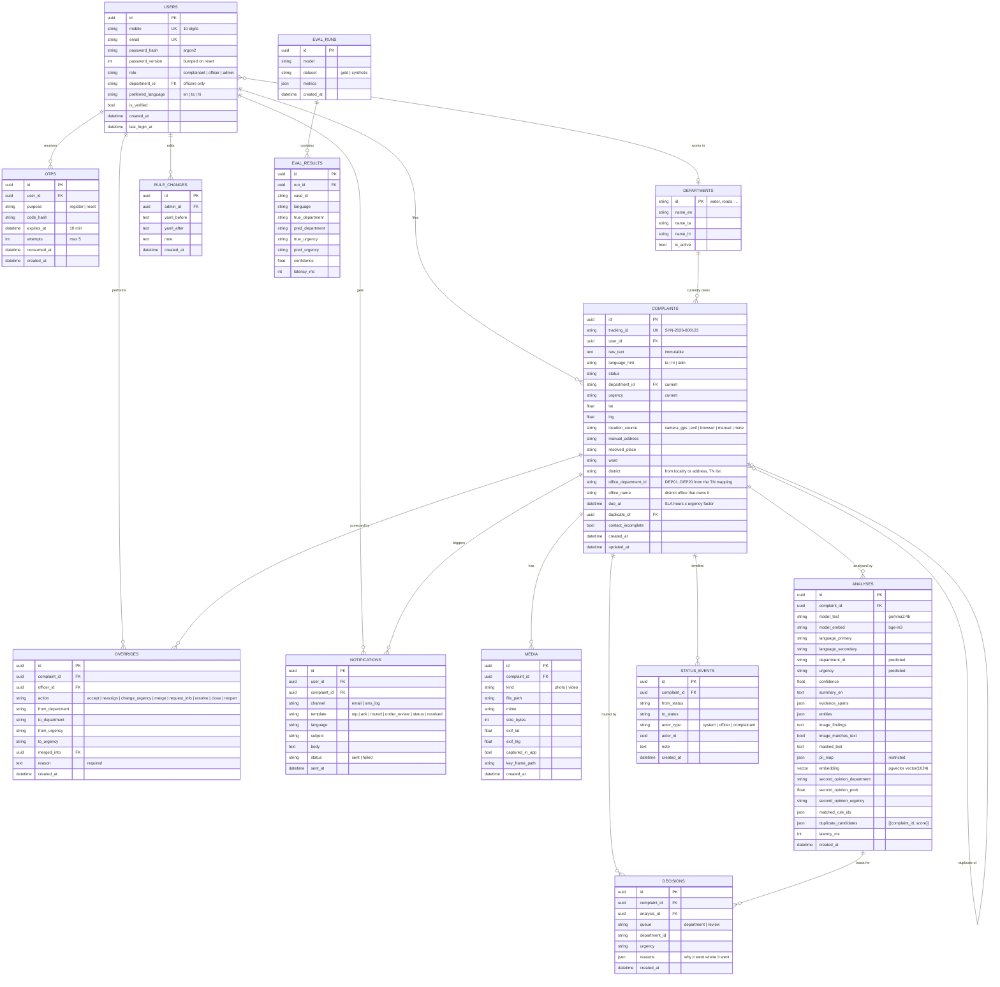
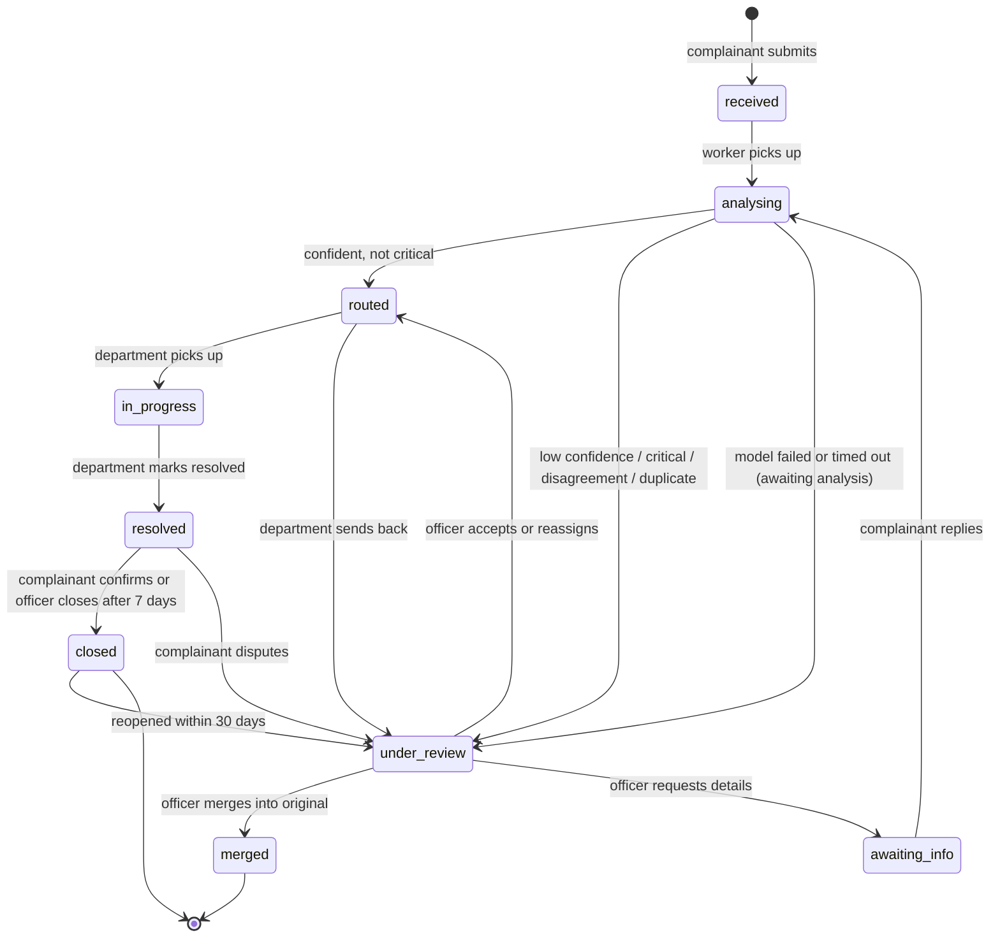

# SYNAPSE: Database and UI/UX Design

## Phase 3 - Checkpoint 3

Covers: data model with ER diagram, table definitions, relationships and integrity rules, the complaint status state machine, how data flows through the tables, and UI/UX wireframes for the three user roles.

Date: 15 October 2026 | Status: Draft v1

---

## 1. Data model

### 1.1 Design rules

1. **Raw complaint text is immutable.** `complaints.raw_text` is written once at intake and never updated. Masked text, translations and summaries live in `analyses`.
2. **Every automated decision and every human action is a row.** `decisions` for the system, `overrides` for officers, `status_events` for the timeline. Nothing is overwritten in place.
3. **A complaint can be analysed more than once** (re-run after the complainant adds information, or after a model change). `analyses` is one-to-many; the latest row is current.
4. **Closing is a human act.** Only an `overrides` row with action `resolve` or `close` by an officer, or a complainant confirmation, moves a complaint to `closed`. No code path lets a model prediction do it.
5. **Personal data is separated.** PII found in the text is stored as a masked map in `analyses.pii_map`, readable only by officer and admin roles. Passwords are argon2 hashes, OTPs are hashed with expiry and attempt counts.
6. **Storage: PostgreSQL 16 with the pgvector extension**, run locally through Docker Compose, accessed from Python through SQLAlchemy 2. Native types are used where they pay off: `uuid` primary keys, `jsonb` for evidence spans, entities, reasons and duplicate candidates, `vector(1024)` for the bge-m3 embedding, `timestamptz` everywhere. Media files live on disk under `media/`, referenced by path.

### 1.2 ER diagram



### 1.3 Tables at a glance

| Table | One row per | Written by | Read by |
|---|---|---|---|
| `users` | registered person | Auth service | everything |
| `otps` | OTP issued | Auth service | Auth service |
| `departments` | department (seeded from `config/taxonomy.yaml`) | seed script, Admin | routing, UI labels in three languages |
| `complaints` | complaint, current state | Complaint service, Review service | all UIs |
| `media` | uploaded photo or video | Complaint service | Officer console, Worker |
| `analyses` | pipeline run on a complaint | Worker | Officer console, Metrics |
| `decisions` | automated routing decision | Worker | Officer console, Metrics |
| `overrides` | officer action | Review service | Metrics (ground truth), audit |
| `status_events` | status change | Complaint service, Review service, Worker | tracking page, audit |
| `notifications` | message sent | Notifier | audit, complainant page |
| `rule_changes` | edit to `rules.yaml` | Admin | audit |
| `eval_runs`, `eval_results` | evaluation run and its rows | eval runner | dashboard |

### 1.4 Indexes

| Index | Why |
|---|---|
| `complaints(status, urgency, created_at)` | review and department queues sorted by urgency then age |
| `complaints(department_id, status)` | department backlog |
| `complaints(user_id, created_at)` | "my complaints" |
| `complaints(tracking_id)` unique | tracking lookup |
| `analyses(complaint_id, created_at desc)` | latest analysis |
| `status_events(complaint_id, created_at)` | timeline |
| `otps(user_id, purpose, created_at desc)` | latest OTP |
| `notifications(user_id, sent_at)` | complainant message history |
| `analyses USING hnsw (embedding vector_cosine_ops)` | pgvector index for duplicate search |

Duplicate search is one SQL query: the latest embedding of the new complaint against the embeddings of open complaints, ordered by cosine distance (`<=>`), limited to the top 5, then filtered in Python by distance between the two locations and by the same complainant. pgvector's HNSW index keeps that fast well beyond hackathon volumes.

### 1.5 Integrity rules enforced in the service layer

- `raw_text` has no update path; the ORM model marks it read-only after insert.
- Every `overrides` row needs a non-empty `reason`.
- Status changes go through one function that checks the state machine below and writes the `status_events` row in the same transaction.
- `duplicate_of` may only point at a complaint that is not itself a duplicate (no chains).
- A merged complaint keeps its own row, status `merged`, and its complainant keeps receiving updates from the original.
- Media routes check that the requester is the complainant, an officer, or an admin.
- `pii_map` is excluded from every API response for the complainant role.
- Deletes are not exposed; records are retained for audit.

---

## 2. Complaint status state machine



Rules:
- Only `analysing` transitions are made by the system, and `analysing` never leads to `closed`, `resolved` or a rejection.
- `under_review` is the safety net. Any doubt lands here; a person moves it on.
- `awaiting_info` keeps the complaint open; nothing is dropped for being incomplete.

---

## 3. Data flow through the tables

| Step | Reads | Writes |
|---|---|---|
| Register / verify / login / reset | `users`, `otps` | `users`, `otps`, `notifications` (OTP email) |
| Submit complaint | `users` | `complaints` (status `received`), `media`, `status_events`, `notifications` (acknowledgement with tracking ID) |
| Worker: language hint, PII mask, geo resolve | `complaints`, `media` (EXIF) | `complaints.resolved_place/ward`, `analyses` (partial) |
| Worker: LLM analysis (Gemma, text + photo) | `analyses` | `analyses` (department, urgency, confidence, evidence, entities, image findings) |
| Worker: embedding + duplicates | open `analyses.embedding` | `analyses.embedding`, `analyses.duplicate_candidates` |
| Worker: second opinion + rules | `config/rules.yaml`, `models/second_opinion_*.npz` | `analyses.second_opinion_*`, `analyses.matched_rule_ids` |
| Worker: decision | `analyses` | `decisions`, `complaints.status/department_id/urgency`, `status_events`, `notifications` (routed or under review) |
| Worker: district office | `config/tn_mapping.json` (38 districts, 20 departments, 760 offices, 41 keyword hints) | `complaints.district/office_department_id/office_name/due_at`; the SLA from the office row times 0.25 for Critical, 0.5 High, 1 Medium, 3 Low |
| Officer action | `complaints`, `analyses`, `decisions`, `media` | `overrides`, `complaints`, `status_events`, `notifications` |
| Admin edits rules | `rules.yaml` | `rules.yaml`, `rule_changes` |
| Dashboard | `analyses`, `overrides`, `decisions`, `eval_runs`, `eval_results` | nothing |
| Eval runner | gold set file | `eval_runs`, `eval_results` |

The metrics service treats an `overrides` row as ground truth for the matching `analyses` row: if an officer reassigns from `health` to `water`, the analysis is counted as wrong on department for that language. That is how live accuracy per language accumulates without a separate labelling step.

---

## 4. UI/UX design

### 4.1 Stack and conventions

- React 18 + Vite, Tailwind CSS, **shadcn/ui** components, **lucide-react** icons, react-router, react-hook-form + zod for forms, i18next for strings, react-leaflet for maps, shadcn Chart (recharts) for the dashboard.
- Mobile-first for the complainant portal (phones, in-app camera, GPS). Desktop-first for the officer console and admin.
- Fonts: Inter plus Noto Sans Tamil and Noto Sans Devanagari so every script renders.
- Every string goes through i18next with `en.json`, `ta.json`, `hi.json`. The language switcher (`Languages` icon) is in the header on every screen.
- Urgency is always a shadcn `Badge` with a fixed colour: Critical red, High orange, Medium amber, Low slate, plus an icon so colour is not the only signal.
- Status is a `Badge` with an icon: received `Inbox`, analysing `Loader2` (spinning), under review `UserCheck`, routed `Send`, in progress `Wrench`, resolved `CheckCircle2`, closed `Lock`, merged `GitMerge`, awaiting info `MessageCircleQuestion`.
- Icon buttons carry `aria-label`s; tap targets are 44 px; contrast meets WCAG AA.

### 4.2 Screen map

```
Complainant (mobile)                  Officer (desktop)                 Admin (desktop)
 C1 Register                           O1 Review queue                   A1 Rules editor
 C2 Verify OTP                         O2 Complaint workspace            A2 Dashboard
 C3 Login / Forgot / Reset             O3 Department queue               A3 Departments and users
 C4 My complaints
 C5 New complaint
 C6 Track complaint
```

### 4.3 Wireframes

**C1 Register and C2 Verify OTP**

```
+--------------------------------------+   +--------------------------------------+
|  SYNAPSE            [Languages v]    |   |  < Back                               |
|                                      |   |                                      |
|  Create your account                 |   |  Check your email                    |
|                                      |   |  We sent a 6-digit code to           |
|  [Phone] Mobile number               |   |  b***@gmail.com                      |
|  [Mail ] Email                       |   |                                      |
|  [Lock ] Password          [Eye]     |   |   [_] [_] [_] [_] [_] [_]  InputOTP  |
|  ==== strength: strong ====          |   |                                      |
|  [ ] I agree to the privacy notice   |   |  ( Verify )                          |
|                                      |   |  Resend code in 0:42   [RefreshCw]   |
|  ( Create account )  Button          |   |                                      |
|  Already registered? Log in          |   |                                      |
+--------------------------------------+   +--------------------------------------+
Card, Form, Input, Button, Checkbox, Progress   Card, InputOTP, Button, Sonner toast
```

**C5 New complaint** (the key screen)

```
+----------------------------------------------+
|  < My complaints      New complaint  [Languages]|
|                                              |
|  Describe the problem in any language        |
|  +------------------------------------------+|
|  | thanni 3 days ah varala, veetla 2 kids   ||
|  | irukanga, rendu perum vomiting...        ||  Textarea (auto-grow)
|  +------------------------------------------+|
|  Detected: Tamil + English   [Badge]         |
|                                              |
|  Photos or video                             |
|  [ Camera ] [ Upload ]   [thumb] [thumb] [x] |  Button (outline) + thumbnails
|                                              |
|  Location                                    |
|  +------------------------------------------+|
|  |        [map preview with pin]            ||  react-leaflet
|  +------------------------------------------+|
|  [LocateFixed] Use current location          |
|  [MapPin] Enter address manually             |
|  Gandhipuram, Coimbatore  (from camera GPS)  |  Alert (info)
|                                              |
|  Contact for updates                         |
|  bala@... , +91 98xxx     [Pencil]           |
|                                              |
|  ( Send complaint )   [Send]                 |  Button (primary, full width)
+----------------------------------------------+
After submit -> Sheet from bottom:
  [CheckCircle2]  Received. Tracking ID SYN-2026-000123
  "We emailed you. We will update you at every step."
  ( Track it )  ( File another )
```

Camera uses `getUserMedia`; `<input type="file" accept="image/*,video/*" capture="environment">` is the fallback. "Use current location" calls the Geolocation API and shows the resolved locality; EXIF GPS from an uploaded photo fills the pin automatically with a note "from photo".

**C6 Track complaint**

```
+----------------------------------------------+
|  < Back       SYN-2026-000123     [Share]    |
|                                              |
|  [Badge: Under review] [Badge: Critical]     |
|  Water Supply  (Tamil: குடிநீர் வழங்கல்)     |
|                                              |
|  Timeline                                    |
|   o Received            15 Oct 10:42         |
|   o Analysed            15 Oct 10:43         |
|   o Sent for review     15 Oct 10:43         |   vertical steps, lucide Circle / CheckCircle2
|   o Routed to Water     --                   |
|   o Resolved            --                   |
|                                              |
|  Why this department?     [Accordion v]      |
|   "thanni 3 days ah varala"  <- highlighted  |
|   Photo: standing water at a tap, no flow    |
|                                              |
|  Your complaint (original text, unchanged)   |
|  [photo] [photo]  [map]                      |
|                                              |
|  Messages from the office                    |
|   [MessageCircleQuestion] Please share the   |
|   exact door number.        ( Reply )        |
+----------------------------------------------+
Card, Badge, Accordion, Separator, Textarea, Button
```

**O1 Review queue**

```
+------------------------------------------------------------------------------------+
| SYNAPSE Officer   [Search complaints...  Command]      [Bell]  [Avatar] Water Dept  |
|------------------------------------------------------------------------------------|
| Tabs: [Review queue 14] [Water queue 32] [All]                                     |
| Filters: Urgency [v]  Language [v]  Flag [v]  Age [v]        [Filter] [RefreshCw]  |
|------------------------------------------------------------------------------------|
| Urg      | ID              | Summary (EN)                  | Lang  | Flags           | Age  |
| [Crit]   | SYN-...123      | No water 3 days, 2 kids sick  | ta+en | [Critical]      | 4m   |
| [Crit]   | SYN-...118      | Power cut, father on oxygen   | en    | [Critical]      | 11m  |
| [High]   | SYN-...121      | Hanging wires near school     | ta    | [Disagree] [Dup]| 20m  |
| [Med]    | SYN-...119      | Street light off 2 weeks      | hi+en | [Low conf 0.61] | 1h   |
| ...                                                                                 |
| Pagination                                                                         |
+------------------------------------------------------------------------------------+
Table, Badge, Tabs, Select, Command, DropdownMenu, Pagination
Flag icons: Critical ShieldAlert, Disagree ArrowRightLeft, Duplicate Copy, Low confidence HelpCircle, Awaiting analysis Clock
```

**O2 Complaint workspace**

```
+------------------------------------------------------------------------------------+
| < Queue   SYN-2026-000123   [Badge: Under review] [Badge: Critical]   [History]    |
|------------------------------+------------------------------+-----------------------|
| ORIGINAL TEXT   [Languages]  | EVIDENCE                     | DECISION              |
| thanni 3 days ah varala sir. | [photo]  [video key frame]   | Model suggests        |
| veetla 2 kids irukanga,      | Image: standing water at a   |  Water Supply   0.95  |
| rendu perum vomiting...      | tap, no flow. Matches text.  |  Critical             |
| (highlights = evidence spans)|                              | Rules matched         |
|                              | [map with pin]               |  R3 keyword "thanni"  |
| English summary (Sparkles)   | Gandhipuram, 0.3 km          |  -> Water             |
| No water for 3 days, two     |                              | Second opinion        |
| children vomiting...         | Entities                     |  Health 0.62 [Disagree]|
|                              |  Location: Anna Nagar 4th St | Duplicates            |
| PII (masked) [Eye]           |  People: 2 kids              |  SYN-...097  0.88     |
|  phone: 98xx xxx 211         |  Duration: 3 days            |  ( Open ) ( Merge )   |
|------------------------------+------------------------------+-----------------------|
| ACTIONS                                                                            |
| ( Accept: Water / Critical )  ( Reassign ) [ArrowRightLeft]  ( Merge ) [GitMerge]  |
| ( Request info ) [MessageCircleQuestion]   ( Mark resolved ) [CheckCircle2]        |
| Reassign dialog: Department [Select v]  Urgency [Select v]  Reason [Textarea] *    |
|------------------------------------------------------------------------------------|
| AUDIT TRAIL                                                                        |
|  10:43 system   decision: review queue (critical; second opinion disagrees)        |
|  10:51 officer  reassigned Health -> Water, reason: "water outage is the cause"    |
+------------------------------------------------------------------------------------+
Resizable panels, Card, Badge, Dialog, Select, Textarea, Tooltip, Separator, Button
```

**A1 Rules editor**

```
+------------------------------------------------------------------------------------+
| Routing rules                                   [Plus] New rule   [Upload] Import   |
|------------------------------------------------------------------------------------|
| [Switch on] R1  gas leak / கேஸ் லீக் / gas ki badbu   -> Safety, Critical, force review|
| [Switch on] R2  oxygen / dialysis / ஆக்ஸிஜன்         -> urgency floor Critical       |
| [Switch on] R3  thanni / தண்ணீர் / paani / water     -> Water                        |
| [Switch off] R4 ward 23-27                        -> Roads (zone B office)          |
|   each row: condition chips, action chips, [Pencil] [Trash2] [FlaskConical] Test    |
|------------------------------------------------------------------------------------|
| Test a rule: [ paste complaint text ]  ( Run )  -> matched: R3 -> Water             |
| YAML preview [Code]  (read-only, download)                                          |
+------------------------------------------------------------------------------------+
Card, Switch, Badge, Dialog (edit), Textarea, Button, Tabs
```

**A2 Dashboard**

```
+------------------------------------------------------------------------------------+
| Dashboard     Model [gemma3:4b v]   Period [Today v]   Eval run [gold 15 Oct v]     |
|------------------------------------------------------------------------------------|
| [Open 212] [Critical open 6] [In review 14] [Median time to route 38 s] [Auto-closed 0]|
|------------------------------------------------------------------------------------|
| Accuracy by language (bar)        | Urgency: predicted vs corrected (heat grid)     |
|  en ████████ 1.00                 |          crit  high  med  low                   |
|  ta ██████   0.83                 |  crit     4     0     0    0                    |
|  hi ██████   0.83                 |  high     1     3     0    0                    |
|  ta-en ████  0.50                 |  ...                                            |
|  hi-en ████  0.50                 |                                                 |
|------------------------------------------------------------------------------------|
| Formal vs informal urgency gap: 0.83 vs 0.83 (no gap)   | Backlog by department (bar) |
| Review-queue rate 35%   Duplicates caught 6/6            | Model latency p50 17 s      |
+------------------------------------------------------------------------------------+
Card (stat tiles), shadcn Chart (BarChart), Table, Select
Icons: BarChart3, Scale (fairness), Clock, ShieldAlert, Copy
```

### 4.4 Component map

| Screen | shadcn/ui | lucide-react |
|---|---|---|
| C1 Register | Card, Form, Input, Button, Checkbox, Progress, Select | Phone, Mail, Lock, Eye, EyeOff, Languages |
| C2 Verify OTP | Card, InputOTP, Button, Sonner | Mail, RefreshCw |
| C3 Login / Reset | Card, Form, Input, Button, Alert | Lock, KeyRound, Mail |
| C4 My complaints | Card list, Badge, Button (FAB), Skeleton, Empty state | Plus, Inbox, Clock, CheckCircle2 |
| C5 New complaint | Textarea, Button, Badge, Alert, Sheet, Dialog (camera), Progress (upload) | Camera, Upload, Image, Video, LocateFixed, MapPin, Pencil, Send, X |
| C6 Track | Card, Badge, Accordion, Separator, Textarea, Button | Circle, CheckCircle2, Share2, MessageCircleQuestion, Sparkles |
| O1 Review queue | Table, Tabs, Badge, Select, Command, DropdownMenu, Pagination, Tooltip | ShieldAlert, ArrowRightLeft, Copy, HelpCircle, Clock, Filter, RefreshCw, Search, Bell |
| O2 Workspace | Resizable, Card, Badge, Dialog, Select, Textarea, Tooltip, Separator, ScrollArea | Languages, Sparkles, Eye, MapPin, GitMerge, ArrowRightLeft, MessageCircleQuestion, CheckCircle2, History |
| O3 Department queue | same as O1 | Wrench |
| A1 Rules | Card, Switch, Badge, Dialog, Textarea, Tabs, Button | Plus, Pencil, Trash2, FlaskConical, Code, Upload |
| A2 Dashboard | Card, Chart, Table, Select | BarChart3, Scale, Clock, ShieldAlert, Copy |
| A3 Departments and users | Table, Dialog, Select, Switch | Users, Building2, UserCog |
| Shared header | NavigationMenu, DropdownMenu, Avatar, Badge | Languages, Bell, LogOut, Settings |

### 4.5 Interaction details that matter for the demo

- **Instant acknowledgement.** Submit returns in under a second with the tracking ID; the card shows "Analysing" with a spinner and flips to the department and urgency when the worker finishes (polling every 3 s, or SSE).
- **Evidence highlighting.** Evidence spans are matched against the raw text and wrapped in `<mark>`; hovering shows "used for urgency" or "used for department".
- **Reason is mandatory.** The Reassign and Merge dialogs disable the confirm button until a reason is typed.
- **Language everywhere.** The officer sees the original text and can toggle the English summary; the complainant sees department names and statuses in their chosen language.
- **No dead ends.** Incomplete contact shows a yellow Alert on the officer side, never a rejection on the complainant side.

---

## 5. Technology stack and why

Four constraints shaped every choice: all inference stays on our own machine (privacy, no cloud AI APIs); the build laptop has an RTX 3050 with 4 GB of VRAM and 15 GB of RAM; Windows Application Control on it blocks unsigned native libraries, so torch and scipy do not load; and the whole thing has to work in 24 hours and be readable by a jury.

### 5.1 Frontend

| Layer | Choice | Why | Instead of |
|---|---|---|---|
| Framework | **React 18 + Vite** | Fastest scaffold, instant reload, the team knows it, and the browser APIs we need (camera, geolocation, file capture) are plain JavaScript | Next.js (server features we do not need), Angular (heavier) |
| Components | **shadcn/ui** | Accessible Radix primitives, copied into our repo so we own and restyle them, Tailwind theming, ready-made Form, Table, Dialog, Sheet, InputOTP, Chart. Team standard. | MUI, Ant Design (heavier bundles, harder to restyle, look generic to a jury) |
| Icons | **lucide-react** | One consistent icon set, tree-shaken, pairs with shadcn, 1,500+ icons including Camera, MapPin, ShieldAlert, GitMerge. Team standard. | Font Awesome (font loading), Material icons (mixed styles) |
| Styling | **Tailwind CSS** | Required by shadcn, utility classes keep the mobile layout fast to iterate | CSS modules (slower to iterate in 24 h) |
| Forms | **react-hook-form + zod** | Password policy, mobile and email validation declared once and shared with the OTP flow; shadcn Form is built on it | Hand-rolled state |
| Language | **i18next** | Every label in English, Tamil and Hindi from three JSON files; switcher in the header | Hard-coded strings |
| Maps | **react-leaflet + OpenStreetMap tiles** | No API key, pin and polygon support, 40 KB | Google Maps (key, billing) |
| Charts | **shadcn Chart (recharts)** | Same theme as the rest of the UI, accessible tooltips, enough for bars and a heat grid | Chart.js (another styling system) |

### 5.2 Backend and pipeline

| Layer | Choice | Why | Instead of |
|---|---|---|---|
| API | **FastAPI + Uvicorn (Python 3.12)** | Same language as the pipeline, async, auto-generated OpenAPI docs the jury can click through, Pydantic schemas double as the LLM JSON schema | Node/Express (would need a second process to reach the Python pipeline), Django (heavier) |
| Background work | **In-process worker thread with a queue** | One process to run in the demo, no broker; the LLM is the bottleneck anyway so one worker is right for a 4 GB card | Celery + Redis (setup time, nothing gained at this scale) |
| Database | **PostgreSQL 16 + pgvector via Docker Compose, SQLAlchemy 2** | Real relational integrity (foreign keys, constraints, transactions) for an audit-heavy system; `jsonb` for the explanation payloads; one `docker compose up` on the laptop that already runs Docker; production-grade story for the jury | SQLite (fine for a demo, no concurrent writers, no vector index) |
| Vector search | **pgvector, HNSW index, cosine distance** | Duplicate search is one SQL query next to the complaint data, no second store, survives restarts | FAISS (native library, would need to be allowed), in-memory NumPy (lost on restart) |
| DB driver | **psycopg 3** (tested: its bundled libpq loads under Application Control on the build laptop) | Fast, async-capable, the SQLAlchemy 2 default for PostgreSQL | pg8000 (pure Python fallback, also installed), psycopg2 (older) |
| Dev services | **Docker Compose: postgres (pgvector image) + Mailpit** | One command starts the database and the local mail inbox; the team already has Docker | Manual installers |
| LLM runtime | **Ollama** | Signed Windows binary that runs despite Application Control, handles GPU/CPU split automatically, JSON-schema constrained output, image input, prompt cache | llama.cpp direct (more wiring), vLLM (Linux and GPU only), cloud APIs (ruled out) |
| LLM | **Gemma 3 4B** | Largest open model with vision that runs on 4 GB; most consistent open model on Tamil and Hindi in IndicVisionBench; caught 4 of 4 Critical cases on our gold set | Gemma 3 12B (does not fit, 5x slower), Qwen3 4B (faster but text-only, missed one Critical case) |
| Embeddings | **bge-m3 via Ollama** | Strongest open multilingual embedding model, 1024-dim, covers Tamil and Hindi, runs on CPU through the same Ollama process | sentence-transformers (needs torch, blocked) |
| Second opinion | **Softmax regression in NumPy** | Trains in seconds, independent of the LLM, no scipy | scikit-learn (needs scipy, blocked), fine-tuned transformer (no time) |
| Language hint | **Unicode script detection** | Three languages, two scripts; zero dependencies, sub-millisecond | fastText (native library) |
| PII | **Regex for Indian patterns** | Aadhaar, PAN, mobile, email, PIN are regular; deterministic and auditable | Presidio (500 MB, English-centric) |
| Geocoding | **Local locality table + haversine; Nominatim behind a flag** | Offline, zero dependencies; street-level only if the organiser network allows | Google Geocoding (key), reverse_geocoder (needs scipy) |
| Media | **Local `media/` folder + Pillow for EXIF** | Simple, auditable; Pillow loads under Application Control | S3-style object storage (later) |
| Auth | **PyJWT + argon2-cffi + email OTP** | Standard, no third-party identity provider, OTP hashed with expiry | OAuth providers (cloud) |
| Email | **Mailpit from Docker Compose in the demo, SMTP by env var** | OTP and status mails visible in a local inbox at `localhost:8025`; runs beside Postgres in the same compose file | SendGrid etc. (cloud) |
| Config | **YAML files hot-reloaded** | Taxonomy, urgency scale and routing rules editable without a redeploy and diffable in git | Rules in the database (needs an editor UI first) |
| Tests | **pytest + `scripts/run_eval.py`** | Pipeline stages unit-tested; the eval runner doubles as the dashboard's data source | none |

### 5.3 Why this is defensible to the jury

- Privacy by architecture: nothing leaves the machine, which is the strongest answer to "what about citizens' data".
- Measured, not assumed: every model choice is backed by numbers from this laptop (see `docs/02-models-and-datasets.md`).
- Explainable by construction: evidence spans, rules, second opinion and image findings are stored per analysis and shown to the officer.
- Fits the hardware: one worker, one GPU model resident, embeddings on CPU, PostgreSQL in a container the laptop already runs.
- Replaceable parts: Ollama model tag, embedding model, database URL and email provider are all environment variables.

---

## 6. Seed data for the demo

- `departments`: the 8 rows from `config/taxonomy.yaml` with Tamil and Hindi names.
- `users`: one admin, two officers (Water, Roads), one complainant test account.
- `complaints`: the 12 gold rows pre-loaded with analyses so the queue and dashboard are not empty at the start of the demo.
- `rules.yaml`: the starter rules shown in A1.

---

## 7. What Checkpoint 4 adds

SQLAlchemy models for the tables above with `create_all` against PostgreSQL (Alembic migrations later), `CREATE EXTENSION vector` on startup, the FastAPI routers from the architecture doc, the worker loop calling `scripts/common.py` functions, and the first three screens (C1, C2, C5) in shadcn/ui.
